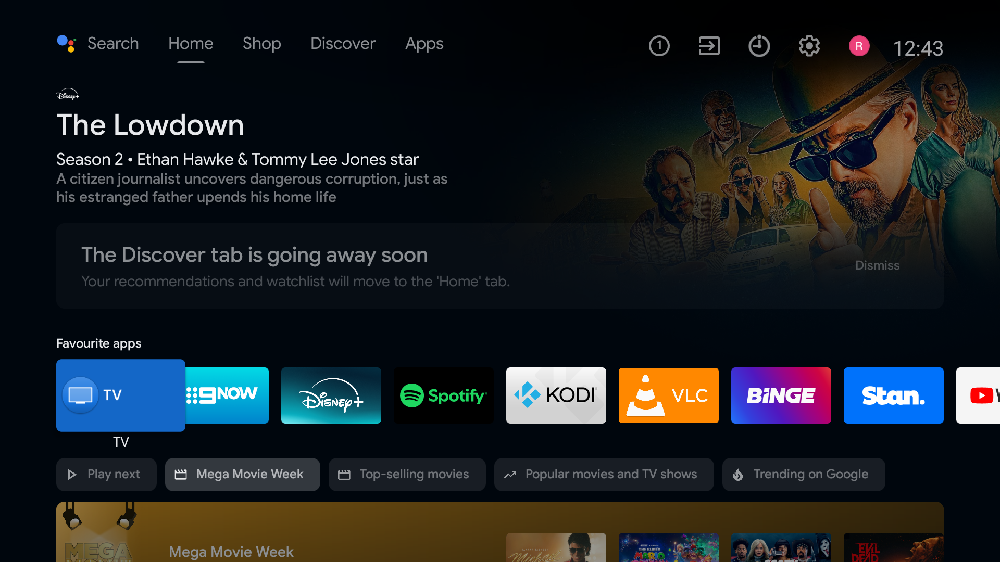
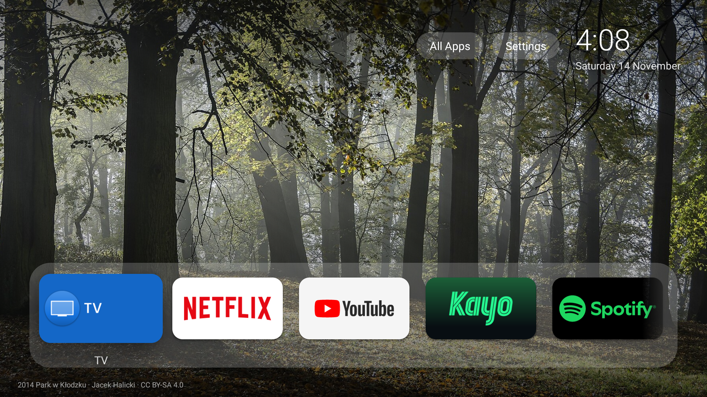
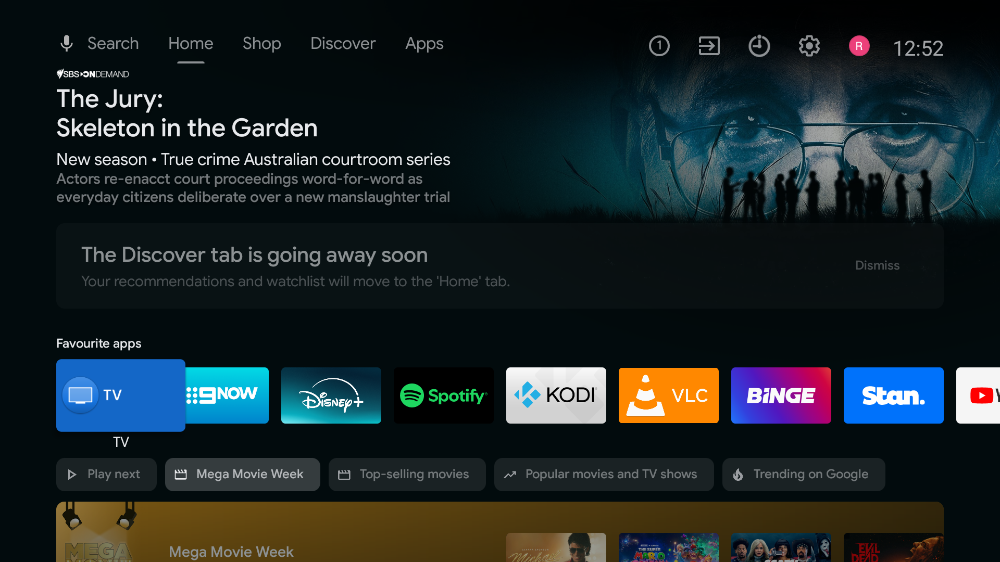
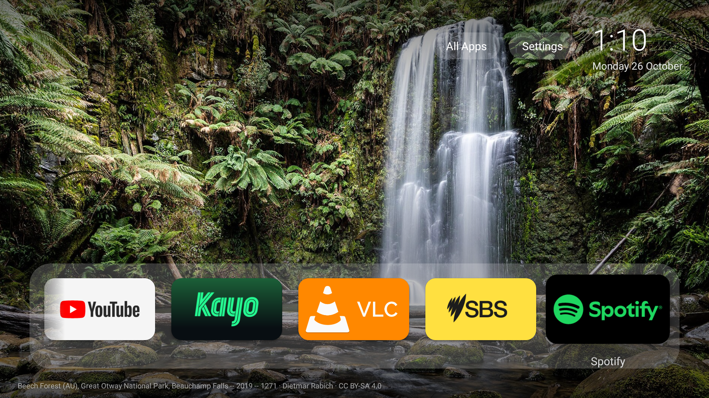

# Sony BRAVIA (Android TV 10) debloat + custom home screen

TV: Sony BRAVIA 4K UR2, 192.168.0.108. Done 2026-10-26.

| Before (stock Google TV) | After (TVHome launcher) |
|---|---|
|  |  |
|  |  |

More screenshots of each step are in [`shots/`](shots/), including the [All Apps screen](shots/10_allapps.png)
and [the 12 wallpapers](shots/wall_contact.jpg).

## Setting up from this repo
Not included: the ADB key, the APK signing keystore, the device backups, the bundled Python libraries (`pylib/`) and
the Android SDK (`sdk/`).
    pip install -r requirements.txt   # or install `adb` (android-tools)
- The TV Control app creates a new `adbkey` on first connect; accept the "Allow USB debugging?" prompt on the TV.
  The scripts (`apply.py` / `restore.py`) expect an `adbkey` next to them, or a system `adb` that's already paired.
- `launcher-source/build.sh` expects JDK 17 and Android build-tools 34 / platform 29 under `sdk/`, and creates a new
  `home.keystore` if there isn't one. A prebuilt `TVHome.apk` is included.
- Set `TV=<ip>` for your own TV; the default IP in `tvadb.py` is the one this was made for.

## Undo / redo
    python3 restore.py                     # re-enable everything, stock home screen back
    python3 restore.py --remove-launcher   # ...and uninstall the custom launcher
    python3 apply.py                       # re-apply (e.g. after a Sony update re-enables things)
    TV=<new-ip> python3 restore.py         # if the TV's IP changed
Uses `adb` if installed, otherwise the bundled `pylib/` (adb-shell) and `adbkey`, which the TV already trusts.
Keep `adbkey` private: anyone with it can control the TV over your network.
Network debugging has to be on (TV Settings → Device Preferences → Developer options) for these scripts to work.

You can also re-enable any single app on the TV itself:
Settings → Apps → See all apps → Show system apps → (app) → Enable.

## What was disabled (`disabled_by_us.txt`, reversible with `pm enable`, nothing uninstalled)
- Telemetry: Samba TV viewing tracker, Sony IDD agent, Qterics device agent, Sony/Google bug-report + feedback senders
- Ads: Sony promos, Google TV recommendations feed, stock Google TV launcher
- Unused features: AirPlay/HomeKit*, Google Assistant voice, Miracast/Wi-Fi Direct, USB recording, timers, reminders

\* AirPlay and HomeKit are "persistent" system apps. Android keeps them running even when they're disabled, and they
can't be stopped over ADB without root. Because AirPlay needs Sony's Vewd web runtime, Vewd (and the red-button/HbbTV
player) was left enabled: disabling it caused a crash loop (see backup/step3_vewd.log).

Kept: Play Store + Play Services (install apps as normal), Chromecast, live TV/tuner, all streaming apps.

## Home screen (`TVHome.apk`, source in `launcher-source/`, build with `launcher-source/build.sh`)
- **Turning the TV on opens Live TV (free-to-air)**, not the home screen (v1.4, 2026-11-14). Press Home for the dock.
  Also applies after a power cut (cold boot). Logic is `screenOn` / `openLiveTvAfterWake` in `HomeActivity.java`.
- Dock: Live TV, Netflix, YouTube, Kayo, Spotify (VLC / SBS On Demand can be re-added from All Apps)
- v1.4 is signed with a new key (`launcher-source/home.keystore`; the original was lost), so it was installed by
  uninstall + reinstall. Keep `home.keystore` so future updates install in place. Old build: `TVHome-1.3.apk`.
  Build tools live in `sdk/` (JDK 17 + Android build-tools 34 / platform 29), used by `launcher-source/build.sh`.
- Hold OK (or press Menu) on a dock tile to move or remove it; in All Apps, hold OK to add an app to the dock
- 12 nature photos rotate every 45 s (from Wikimedia Commons; credits in `launcher-source/assets/walls/CREDITS.txt`
  and shown on screen); rotation pauses and the photos are released from memory while an app is open

## Backups (`backup/`), taken before any change
Package lists (all/disabled/3rd-party), global/secure/system settings, home activity, usage stats, getprop, step logs.
Screenshots of every step are in `shots/`.

## TV Control app (`app/`, GUI for any Android TV / Google TV / Chromecast / Fire TV)
    app/install.sh        # once: adds "TV Control" to the app menu (and a `tv-control` command)
- Add devices with **+** (it scans the network for devices with ADB debugging on) or by IP address.
- **Features**: switches grouped as tracking / ads / voice / casting / preinstalled apps / updates / home screen.
  Only features whose apps exist on that device are shown. **All apps**: every package, with search and filters.
  Core system apps are locked so they can't be turned off.
- Nothing changes until **Apply to device**. Menu: *Select recommended*, *Re-apply my previous choices*
  (after a system update), *Restore everything this app disabled*.
- **Home screen**: install TVHome and switch between it and the stock launcher (Fire OS won't allow other launchers).
- Per-device state and a copy of each device's original package state: `~/.config/tv-control/<device>/`.
